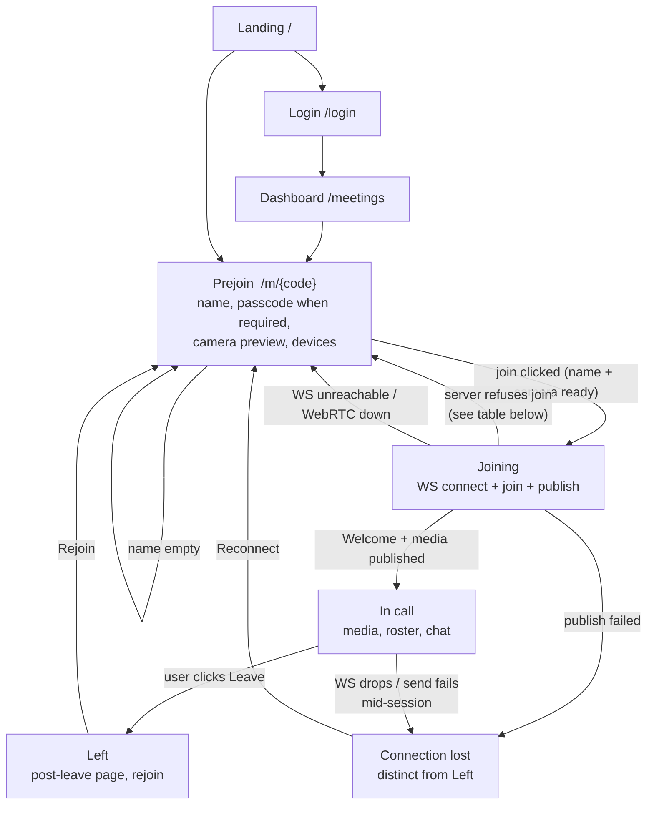

# The meeting user flow

This is the explicit user-flow state machine for the web client
(`crates/web`). The code is organized to match it:

- the states live in `crates/web/src/flow.rs` (`FlowPhase`, `LeaveKind`,
  `JoinError`);
- `MeetingFlow` (in `crates/web/src/call.rs`) owns the current phase, spawns
  one session task per join attempt, and renders the view for each phase;
- `Prejoin` (in `crates/web/src/prejoin.rs`) is the `Prejoin` state's view.

## State diagram



Plain-text version of the same diagram:

```
Landing (/) ──login──> Login (/login) ──> Dashboard (/meetings)
   │                                      │
   └──────join link──────> Prejoin (/m/{code}) <──── rejoin/reconnect ───┐
                                  │                                     │
                                  │ join (name + camera ready)           │
                                  v                                     │
                              Joining ──refused/unreachable────────────>┘
                                  │
                                  │ Welcome + publish ok
                                  v
                              In call ──Leave──> Left (post-leave page)
                                  │
                                  └──drop/fail──> Connection lost
```

## States

| State | Where the user is | What is honest to show |
| --- | --- | --- |
| `Prejoin` | `/m/{code}`: name, passcode (when the meeting has one), camera preview, device pickers | Meeting title + when it opens (fetched from `GET /api/meetings/{code}`), camera loading state, camera errors with retry |
| `Joining` | join clicked, handshake in flight | A distinct loading page; the prejoin page must not stay interactive |
| `InCall` | media flows, roster + chat live | Roster, tiles, transient in-call notices |
| `Left` | the user clicked Leave | A designed post-leave page: what the meeting was, Rejoin, back-to-dashboard |
| `ConnectionLost` | the WS dropped or a send failed mid-call | A page distinct from `Left`: the reason, Reconnect, back-to-dashboard |

Failure exits are *return transitions*: every join-time failure returns to
`Prejoin` with a distinct, actionable message (and, for a taken name or a
wrong/missing passcode, an inline error on the offending field). Mid-call
failures terminate into `ConnectionLost`. Only the user's own Leave button
terminates into `Left`.

## Every join failure path, mapped

The server's join paths are `session.rs::expect_join` / `try_join`; the
client maps each one to a distinct `JoinError` in `flow.rs`:

| Server path (`try_join` / handshake) | `JoinError` | What the user sees |
| --- | --- | --- |
| WS connect fails | `Unreachable` | "Can't reach the server" + how to fix + Try again |
| `RTCPeerConnection` construction fails | `PeerSetup` | "WebRTC is unavailable in this browser" + detail |
| `MeetingNotFound` ("no meeting with that code") | `NotFound` | "This link doesn't match a meeting" + ask for a fresh link |
| `MeetingNotYetOpen` ("has not started yet") | `NotOpenYet { opens_at }` | "The meeting hasn't started yet" + when it opens, from the prejoin fetch of `GET /api/meetings/{code}` |
| `MeetingEnded` | `Ended` | "This meeting has ended" |
| `MeetingCancelled` | `Cancelled` | "This meeting was cancelled" |
| `NameTaken` | `NameTaken` | **inline field error** under the name input, keeping everything the user typed |
| `PasscodeRequired` (missing or wrong passcode) | `PasscodeRequired` | **inline field error** under the passcode field ("This meeting needs a passcode"), keeping everything the user typed |
| `CapacityReached` ("this meeting is full") | `Full` | "This meeting is full" + ask the organizer to make room |
| `InvalidMessage` / `Internal` / `Unauthorized` | `Server(msg)` | "Couldn't join" + the server's message + Try again |
| protocol version mismatch (`Welcome`) | `ProtocolVersion(v)` | "This server speaks a newer protocol" + update hint |
| `expect_join` socket error before Welcome | `Unreachable` | as above |
| publish fails after a successful join | `ConnectionLost` | the post-leave-style page with the reason and Reconnect |

Mid-call failure paths (any `read_server_message` / `handle_server_message`
/ send error after `InCall`) land in `ConnectionLost` with the raw error as
the reason. The user-initiated `Leave` path always lands in `Left`.
